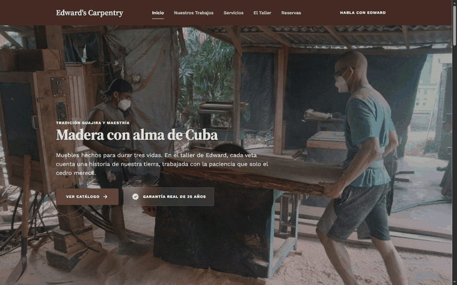
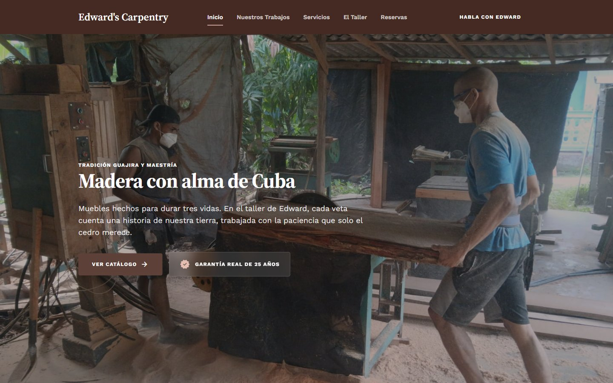
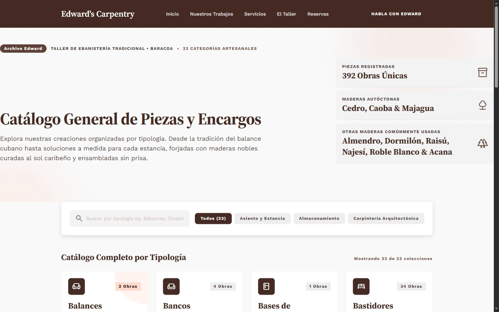
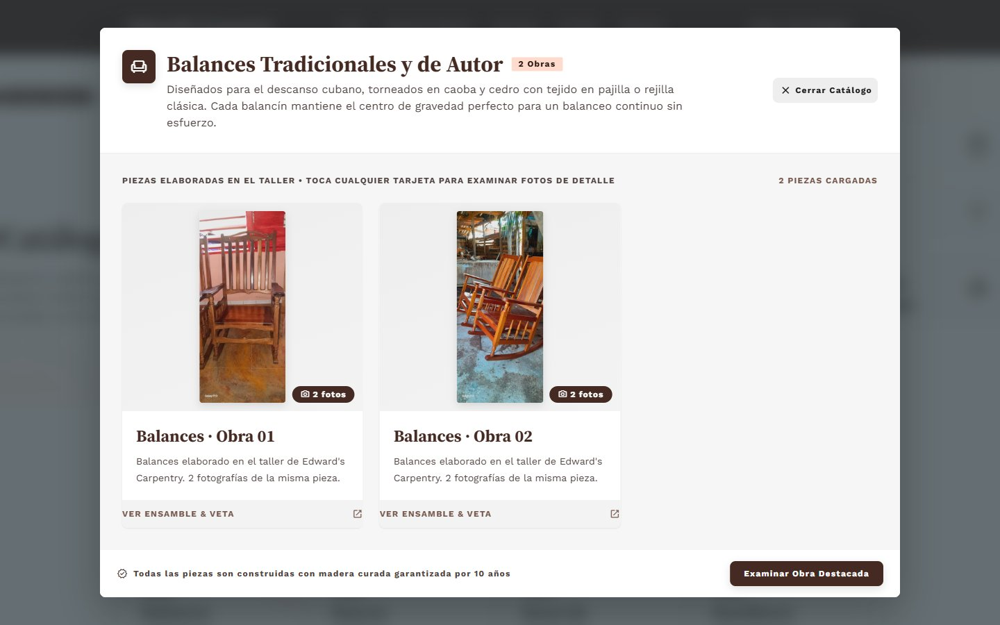
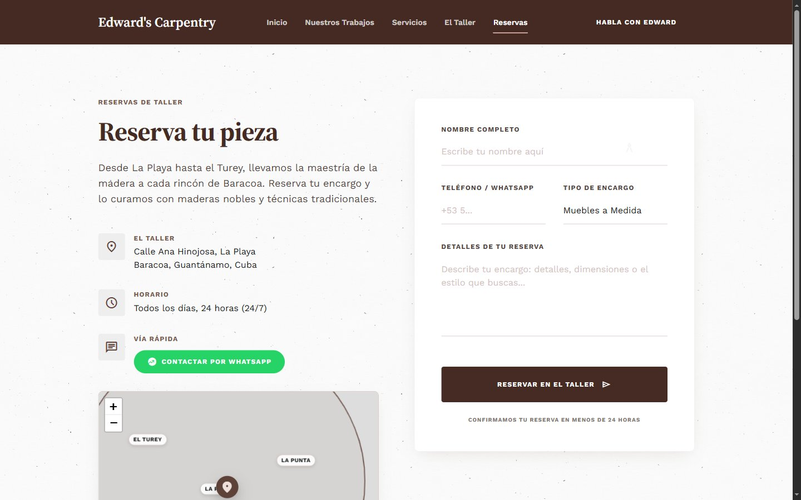
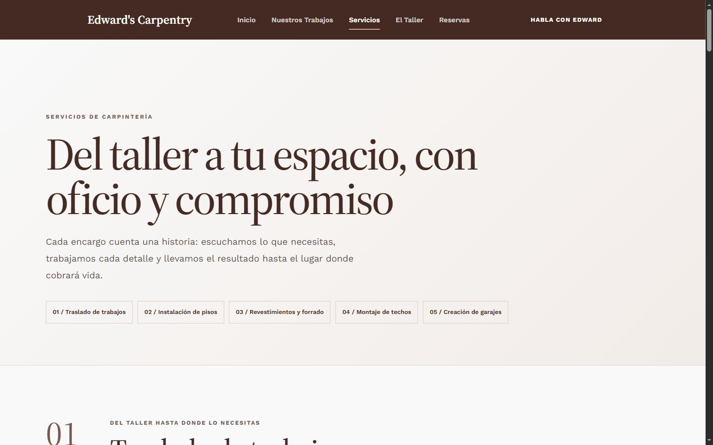
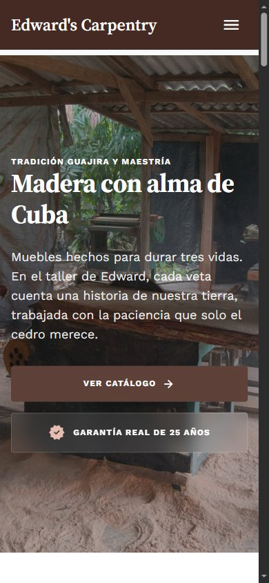
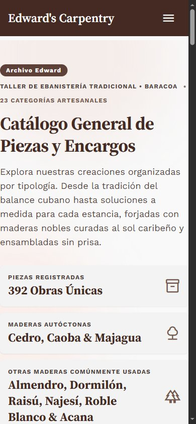
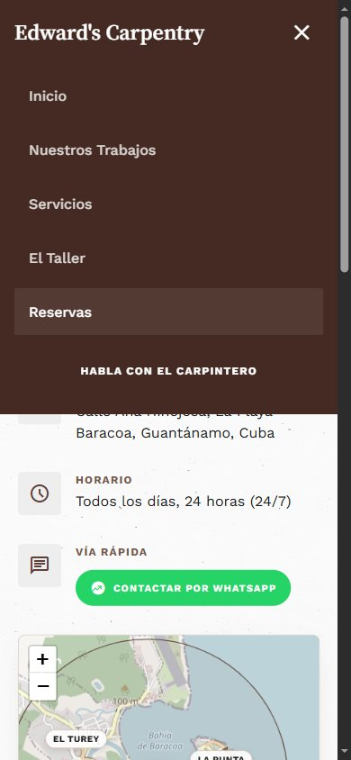
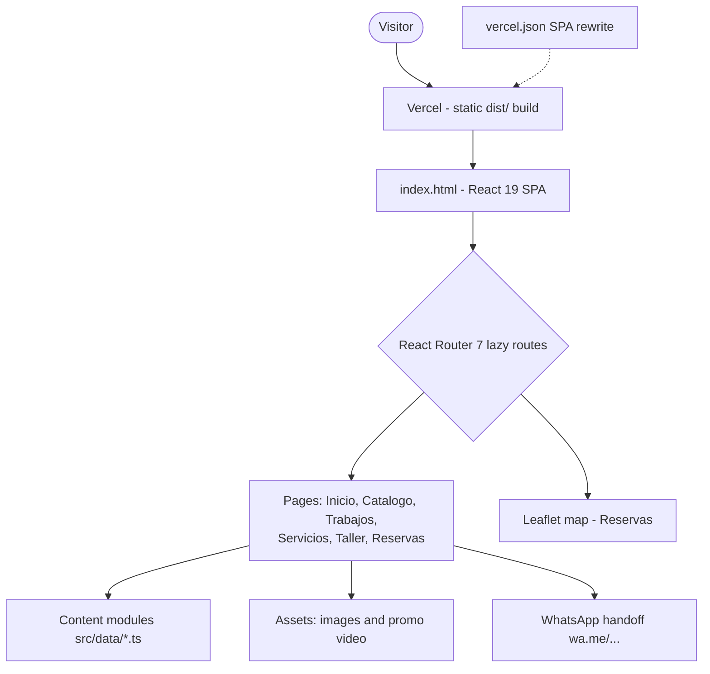

# Edward's Carpentry

[](https://edwards-carpentry.vercel.app)
[](https://react.dev)
[](https://www.typescriptlang.org)
[](https://vitejs.dev)
[](https://edwards-carpentry.vercel.app)

Marketing site for **Edward's Carpentry**, a traditional woodworking shop based in Baracoa, Cuba. The site showcases custom furniture, doors, windows, flooring, and architectural carpentry, with a browsable catalog and a booking flow that hands off to WhatsApp.

**Live demo:** https://edwards-carpentry.vercel.app

## Demo



## Screenshots

### Desktop (1440 x 900)

**Landing page - hero with the 25-year warranty claim**



**Catalog - 23 typologies, search and category filters**



**Category modal - piece gallery with photo viewer links**



**Booking page - project form, workshop info, Leaflet map of Baracoa and WhatsApp handoff**



**Services page**



### Mobile (390 x 844)

| Hero | Catalog | Booking |
| --- | --- | --- |
|  |  |  |

More captures (full-page desktop/mobile, portfolio, workshop, testimonials, call to action) live in [`docs/screenshots/`](docs/screenshots/).

## Architecture



## Features

- **Landing page** with hero, team, wood materials, promotional video, ambience gallery, testimonials, and a call to action.
- **Catalog** of pieces grouped by category (seating, storage, architecture) with filters, detail modals, galleries, and lightbox.
- **Portfolio** of completed work with a showcase and image viewer.
- **Services** page documenting delivery, flooring, cladding, ceiling installation, and garage construction with photo/video galleries.
- **Workshop** page telling the story of the shop, its process, values, and the two craftsmen behind it.
- **Booking page** with a project form, contact details, an interactive Leaflet map of Baracoa, and direct WhatsApp handoff.
- Responsive layout, CSS Modules, route-based document titles, and lazy-loaded pages.

## Routes

| Route | Page |
| --- | --- |
| `/` | Inicio (home) |
| `/catalog` | Catálogo de piezas |
| `/trabajos` | Nuestros trabajos |
| `/servicios` | Servicios |
| `/taller` | El taller |
| `/reservas` | Reservas / presupuesto |
| `/presupuesto` | Redirects to `/reservas` |

## Tech Stack

- **React 19** + **TypeScript 5.9**
- **Vite 7** (via `rolldown-vite`) with React plugin
- **React Router 7** (`BrowserRouter`, lazy routes)
- **Leaflet 1.9** for the workshop map
- **CSS Modules** and global design tokens (no UI framework)
- **ESLint 9** with TypeScript and React Hooks rules

## Project Structure

```
.
├── index.html                 # HTML shell, meta/OG tags
├── public/                    # Static assets served as-is
├── src/
│   ├── App.tsx                # Router and lazy route definitions
│   ├── main.tsx               # React entry point
│   ├── assets/
│   │   ├── images/            # Carpentry, catalog, services, wood, workers
│   │   └── videos/            # Promotional video
│   ├── components/
│   │   ├── atoms/             # Buttons, icons, inputs, labels, badges
│   │   ├── molecules/         # Cards, galleries, modals, map, fields
│   │   ├── organisms/         # Page sections (Hero, Navbar, Footer, etc.)
│   │   └── layout/            # MainLayout and Container
│   ├── data/                  # Catalog, services, materials, workshop content
│   ├── pages/                 # Inicio, Catalogo, NuestrosTrabajos, Servicios, Taller, Reservas
│   ├── styles/                # tokens.css, globals.css, animations.css
│   └── utils/                 # WhatsApp helpers, document title hook
├── compress-images.mjs        # Optional JPEG optimization script (sharp)
└── vite.config.ts             # Vite config with vendor chunk splitting
```

## Getting Started

### Requirements

- Node.js **20.19+** or **22.12+** (required by Vite 7)
- npm

### Install

```bash
npm install
```

### Development

```bash
npm run dev
```

Vite serves the app at the URL printed in the terminal (typically `http://localhost:5173`).

### Build

```bash
npm run build
```

Runs `tsc -b` and outputs a production bundle to `dist/`.

### Preview production build

```bash
npm run preview
```

### Lint

```bash
npm run lint
```

## Content and Customization

Most of the site's copy and media references live in `src/data/`:

- `catalog.ts`, `catalog-groups.ts`, `catalog-images.ts`, `catalog-works.ts` — catalog categories, pieces, and image mappings.
- `services.ts` — services sections, galleries, and video references.
- `materials.ts` — the four featured woods (almendro, dormilón, raisú, najesí).
- `workshop.ts`, `workshop-history.ts`, `workshop-team.ts`, `workshop-values.ts`, `workshop-resilience.ts` — workshop story and team.
- `works-showcase.ts`, `works-showcase-dividers.ts` — portfolio content.
- `testimonials.ts`, `promo-video.ts` — social proof and video section.
- `reservas.ts` — booking form options, contact info, and map coordinates.

Global styling lives in `src/styles/tokens.css` (colors, spacing, typography) and `src/styles/globals.css`.

### WhatsApp contact

The phone number and helper functions are defined in `src/utils/whatsapp.ts`:

```ts
const WHATSAPP_PHONE = "5353166388";
```

Update this value to change the contact number across the site.

### Image optimization

`compress-images.mjs` is a maintenance script that downsizes JPEGs under `src/assets` to a maximum edge of 1600 px at quality 82. It requires [`sharp`](https://sharp.pixelplumbing.com/) to be installed and takes the project root as an argument:

```bash
node compress-images.mjs . --dry   # preview only
node compress-images.mjs .         # rewrite files
```

## Deployment

The build output is fully static, so `dist/` can be deployed to any static host (Netlify, Vercel, GitHub Pages, Cloudflare Pages, etc.). Because the app uses `BrowserRouter`, the host must rewrite unknown paths to `index.html` so client-side routes work on a direct load or refresh. `vercel.json` already contains that rewrite:

```json
{
  "rewrites": [{ "source": "/(.*)", "destination": "/index.html" }]
}
```

Without it, visiting a deep link such as `/catalog` or `/reservas` directly returns a 404 even though in-app navigation works.

## License

Private project. All rights reserved.
